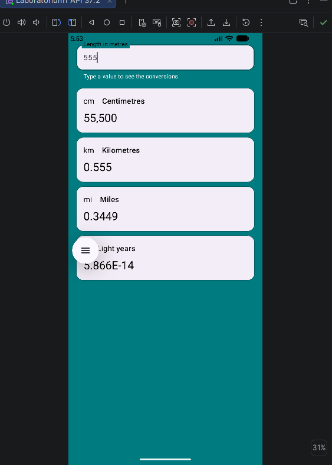
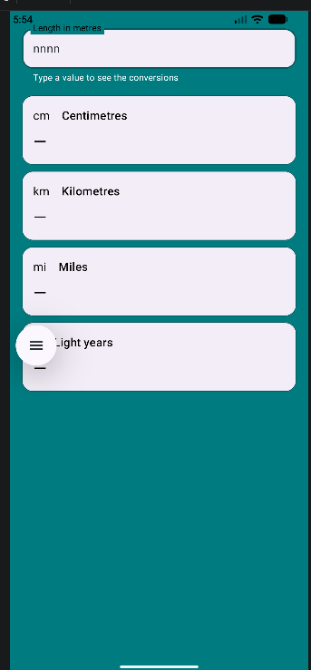
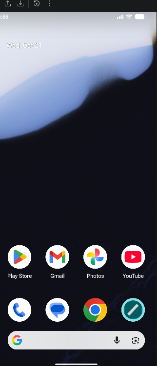
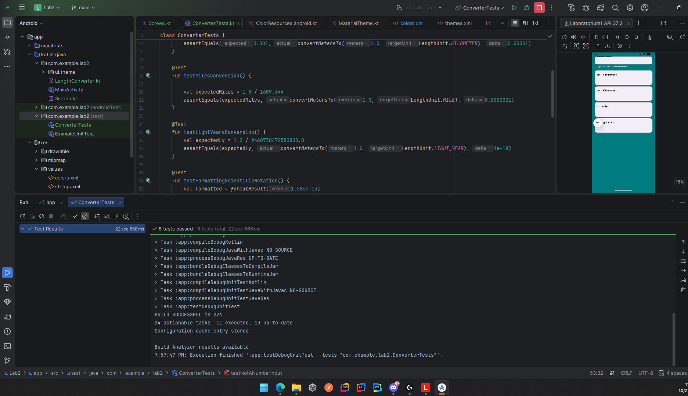

# Przelicznik miar (Length Converter)

Aplikacja mobilna na system Android (Jetpack Compose) służąca do przeliczania długości wyrażonej w metrach na centymetry, kilometry, mile oraz lata świetlne. Projekt zrealizowany w ramach laboratorium z Programowania Systemów Mobilnych.

## 1. Zrzuty ekranu aplikacji

Poniżej przedstawiono główne ekrany aplikacji, w tym stan początkowy (obsługujący również puste i błędne wejście) oraz stan prezentujący przeliczone na bieżąco wyniki.

## 2. Ikona aplikacji

Aplikacja posiada własną ikonę adaptacyjną (Adaptive Icon) poprawnie wyświetlającą się w systemowej szufladzie aplikacji.

## 3. Blokada orientacji na telefonie i tablecie

W pliku `AndroidManifest.xml` dodano atrybut `android:screenOrientation="portrait"`. 
* **Na telefonie:** Atrybut działa poprawnie, a interfejs aplikacji jest sztywno zablokowany w orientacji pionowej (nie obraca się przy fizycznym obrocie urządzenia).
* **Na tablecie:** Aplikacja ignoruje blokadę i obraca się wraz z ekranem. Wynika to ze zmian w nowoczesnym systemie Android (od API 37). System wymusza ignorowanie atrybutów blokujących orientację dla urządzeń o dużych ekranach (gdzie najmniejszy bok wynosi co najmniej 600 dp, jak np. tablety, urządzenia składane), aby zapewnić użytkownikom swobodę korzystania z trybu wielookienkowego i desktopowego.

## 4. Co powinno zastąpić blokowanie orientacji?

Zamiast siłowo blokować orientację ekranu, aplikacje powinny opierać się na **układzie adaptacyjnym (Adaptive Layout)** z wykorzystaniem **klas rozmiarów okna (Window Size Classes)**. Polega to na dynamicznym sprawdzaniu dostępnej przestrzeni (np. kategoria *Compact*, *Medium*, *Expanded*) i dostosowywaniu interfejsu w locie. Dzięki temu, zamiast rozciągać pionowy widok na poziomym tablecie, aplikacja może przebudować UI na dwie kolumny, w pełni wykorzystując szeroki ekran.

## 5. Formatowanie wyników

Podczas przeliczania wartości mamy do czynienia ze skrajnymi wielkościami (np. od lat świetlnych rzędu $10^{-16}$ do setek tysięcy centymetrów). Do rozwiązania tego problemu wykorzystano klasę `NumberFormat` i dostosowano wyświetlanie:
* **Bardzo małe liczby:** Mechanizm automatycznie przechodzi w czytelną **notację wykładniczą** (np. `1.586E-13`), co zapobiega wyświetlaniu bezużytecznych wyników w postaci `0.00`.
* **Standardowe i duże liczby:** Zastosowano standardową notację dziesiętną wraz z **separatorem tysięcy** (np. `100 000` lub `100,000` w zależności od `Locale`), co sprawia, że duże wartości w centymetrach czy milach są łatwe do odczytania.

## 6. Testy jednostkowe

Funkcje odpowiadające za logikę konwersji i formatowania są czystymi funkcjami (pure functions) oddzielonymi od interfejsu Compose, co pozwoliło na wykonanie szybkich, lokalnych testów jednostkowych (JUnit).

Testy pokrywają:
* Przeliczniki dla wszystkich czterech jednostek.
* Puste pole wejściowe i tekst niebędący liczbą.
* Progi formatowania (w tym przejście na notację wykładniczą).

*Wszystkie testy jednostkowe zakończyły się sukcesem.*